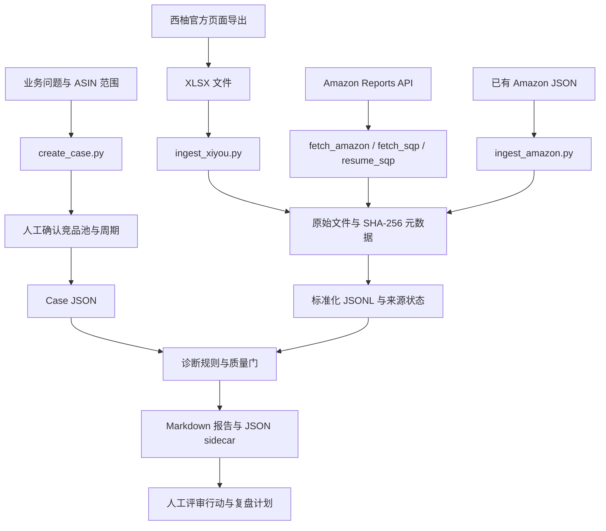

# 西柚多 ASIN 竞品分析

## 一眼看懂

- 这是什么：对比自家 ASIN 和竞品的流量与转化，找出问题环节。
- 什么时候用：自家 ASIN 自然流量或转化突然下滑，要查原因时。
- 给它什么：西柚导出表、亚马逊后台报告和竞品清单。
- 它给你什么：一份带数据出处的报告，指出断点和下一步动作。

## 项目简介

`xiyou-asin-analysis` 是一个 Amazon 多 ASIN 竞品分析 Agent Skill，配套 Python 命令行工具。输入自身 ASIN、竞品池、分析周期、西柚官方导出和 Amazon SP-API 报告，按“覆盖 → 排名 → 点击 → 转化”定位问题，生成带证据引用的 Markdown 报告。

Python 脚本负责文件归档、指标清洗、诊断规则和报告生成；[SKILL.md](SKILL.md) 规定 Agent 的取数顺序、人工确认和行动评审。脚本不会自动修改广告、Listing、价格或促销。

## 核心功能

- 创建包含站点、自身 ASIN、4–8 个竞品、周期和业务问题的 Case，保留竞品池待审核状态。
- 导入西柚 XLSX，识别总览和关键词数据，记录来源周期及第三方估算层级。
- 通过 Amazon SP-API 获取 Sales and Traffic、SQP 报告，或导入已有 Sales and Traffic JSON。
- SQP 按完整周取数，保存 `reportId`，中断后按原报告恢复；同周期报告保留原始版本。
- 为原始文件记录 SHA-256、采集时间、字段定位器和 Evidence ID，保存标准化 JSONL 与来源状态。
- 输出漏斗诊断、关键词差距、证据引用，以及质量门、结论、行动和复盘计划的 JSON sidecar。
- 用合成 Case 离线回放，检查报告引用和证据链；分发检查验证 Skill 结构、Python 语法及敏感内容。

西柚数据是第三方估算，不能替代 Amazon 后台事实。缺少 SQP、广告或页面证据时，对应结论保持缺失或待验证。

## 技术栈

| 用途 | 技术 | 仓库声明 |
| --- | --- | --- |
| CLI 与诊断逻辑 | Python、argparse、标准库 | Python 3.12+ |
| XLSX 读取与合成样例 | openpyxl | `>=3.1,<4` |
| Amazon API 请求 | requests | `>=2.32,<3` |
| 证据与输出 | JSON、JSONL、Markdown、SHA-256 | 本地文件，无数据库服务 |
| 测试与构建配置 | pytest、setuptools | pytest `>=8.3,<9`；setuptools `>=75` |
| CI | GitHub Actions | Windows、Python 3.12，运行测试、合成回放和分发检查 |

依赖范围见 [requirements.txt](requirements.txt) 和 [pyproject.toml](pyproject.toml)；仓库没有依赖锁文件。

## 快速开始

### 环境要求

- Python 3.12+、Git，Windows、macOS 或 Linux；CI 配置覆盖 Windows。
- 只运行合成回放不需要账号或浏览器。
- 获取真实 Amazon 数据需要已注册的 SP-API 应用、卖家授权的 LWA refresh token 和目标站点权限；SQP 另需相应权限。
- 西柚数据由已登录的 Chrome/Chromium 页面通过官方下载取得；仓库不提供浏览器登录或 Cookie 提取工具。

### 安装

```bash
git clone https://github.com/fubo-ops/xiyou-asin-analysis.git
cd xiyou-asin-analysis
python -m venv .venv
```

激活虚拟环境：Windows PowerShell 使用 `.venv\Scripts\Activate.ps1`，macOS / Linux 使用 `source .venv/bin/activate`。然后安装依赖：

```bash
python -m pip install -r requirements.txt
```

作为 Agent Skill 使用时，将完整仓库目录复制到宿主的 skills 目录，目录名保持 `xiyou-asin-analysis`。宿主目录包括 `~/.codex/skills/`、`~/.claude/skills/` 和 `~/.hermes/skills/`。`SKILL.md`、`references/`、`assets/` 和 `scripts/` 应一并保留。

### 使用

先运行不联网的合成回放。`--work-dir` 必须是新目录或空目录：

```bash
python scripts/smoke_test.py --work-dir .smoke-run
python scripts/validate_distribution.py
```

回放会生成合成 XLSX、登记 Amazon JSON、清洗指标并生成报告，成功时输出 `status: PASS` 和 `synthetic_data: true`。

真实任务先按 [接入说明](references/SETUP.md) 将 `.env.example` 复制为本机 `.env`，填写 SP-API 配置；从西柚官方页面下载对应周期的 XLSX。以下 ASIN 和日期仅为格式占位，使用时替换为已确认的任务范围：

```bash
python scripts/create_case.py --output work/case.json --marketplace US --own-asin B000000001 --competitor B000000002 --competitor B000000003 --competitor B000000004 --competitor B000000005 --period-start 2026-01-01 --period-end 2026-01-30 --objective "定位自然流量下滑的最早漏斗断点"
python scripts/ingest_xiyou.py --case work/case.json --data-dir work/data --file exports/xiyou-export.xlsx --source-period-start 2026-01-01 --source-period-end 2026-01-30 --period-basis official_export_selected_1m
python scripts/fetch_amazon.py --case work/case.json --data-dir work/data
python scripts/build_report.py --case work/case.json --data-dir work/data --output work/report.md
```

Case 创建后仍需按 Skill 流程确认竞品池、周期和业务问题。报告会同时输出 `*.diagnostics.json`、`*.quality-gates.json`、`*.claims.json`、`*.action-plan.json` 和 `*.review-plan.json`；建议动作需另经人工评审。

已有 SQP `reportId` 时，使用原报告恢复，不重复创建：

```bash
python scripts/resume_sqp.py --case work/case.json --data-dir work/data --report-id REPORT_ID --period-start 2026-01-04 --period-end 2026-01-10
```

真实 Case、原始导出、报告和凭据保存在被忽略的运行目录中。`cases/synthetic-case/` 只保留仓库合成样例。

## 项目结构

以下列出全部已跟踪文件。`.env`、`work/`、`data/`、`reports/` 和合成回放输出是本机运行文件，不在结构树中。

```text
xiyou-asin-analysis/
├── .env.example
├── .github/
│   └── workflows/
│       └── verify.yml
├── .gitignore
├── LICENSE
├── README.md
├── SKILL.md
├── assets/
│   └── report-template.md
├── cases/
│   └── synthetic-case/
│       ├── amazon-sales-traffic.json
│       ├── case.json
│       └── xiyou-fixture.json
├── docs/
│   └── archive/
│       ├── 2026-08-13-single-source-repository-design.md
│       └── 2026-08-13-single-source-repository.md
├── pyproject.toml
├── references/
│   ├── DATA-SOURCES.md
│   ├── DIAGNOSTIC-RULES.md
│   ├── FIELD-CONTRACTS.md
│   └── SETUP.md
├── requirements.txt
├── scripts/
│   ├── _runner.py
│   ├── _test_distribution_contract.py
│   ├── build_report.py
│   ├── create_case.py
│   ├── fetch_amazon.py
│   ├── fetch_sqp.py
│   ├── ingest_amazon.py
│   ├── ingest_xiyou.py
│   ├── register_evidence.py
│   ├── resume_sqp.py
│   ├── smoke_test.py
│   ├── validate_distribution.py
│   └── xiyou_skill/
│       ├── __init__.py
│       ├── __main__.py
│       ├── amazon_spapi.py
│       ├── cli.py
│       ├── diagnostics.py
│       ├── governance.py
│       ├── models.py
│       ├── normalize.py
│       ├── raw_store.py
│       ├── report.py
│       ├── source_versions.py
│       └── xiyou.py
├── tests/
│   ├── test_amazon.py
│   ├── test_cli.py
│   ├── test_diagnostics.py
│   ├── test_governance.py
│   ├── test_raw_store.py
│   ├── test_report.py
│   ├── test_repository_contract.py
│   ├── test_verify_phase2.py
│   └── test_xiyou.py
└── tools/
    └── verify_phase2.py
```

`SKILL.md`、`references/` 和 `assets/` 是 Skill 分发入口与配套资料；`docs/archive/` 保存已完成的单一源码迁移阶段文档。

## 架构图



命令行入口通过 `scripts/_runner.py` 调用唯一实现包 `scripts/xiyou_skill/`。原始数据保留版本和证据定位，报告根据来源、周期与质量门决定哪些结论可以输出。

## 当前状态与开发计划

`pyproject.toml` 版本为 `0.1.0`。当前实现包括 Case 管理、西柚导入、Amazon Sales and Traffic / SQP 获取与恢复、证据归档、诊断和报告生成。测试覆盖清洗、来源版本、质量门、报告、CLI 及仓库分发约定。

单一源码迁移已经体现在当前目录、测试和 CI 配置中，旧设计与执行计划保存在 `docs/archive/`。后续功能排期、发布里程碑和真实业务验收记录待补充。

仓库没有广告 API 获取入口；涉及广告指标的结论需要另行提供相应证据。浏览器取数、竞品池确认和行动审批仍按 Skill 由人或宿主 Agent 执行。已有开发依赖时，可运行与 CI 对应的检查：

```bash
python -m pytest -q
python scripts/smoke_test.py --work-dir .smoke-ci
python scripts/validate_distribution.py
git diff --check
```

## 文档

- [Skill 入口](SKILL.md)、[接入说明](references/SETUP.md)
- [数据源](references/DATA-SOURCES.md)、[字段契约](references/FIELD-CONTRACTS.md)
- [诊断规则](references/DIAGNOSTIC-RULES.md)、[报告模板](assets/report-template.md)
- [合成 Case](cases/synthetic-case/case.json)、[CI 配置](.github/workflows/verify.yml)
- [单一源码迁移设计（归档）](docs/archive/2026-08-13-single-source-repository-design.md)、[迁移执行计划（归档）](docs/archive/2026-08-13-single-source-repository.md)

## 许可证

[MIT License](LICENSE)，Copyright (c) 2026 fubo-ops。
