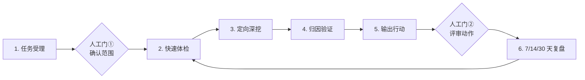

# xiyou-asin-analysis

`xiyou-asin-analysis` 是一个基于“问题驱动诊断循环”的亚马逊多 ASIN 竞品分析 Agent Skill。Agent 按需调用西柚官方浏览器导出和 Amazon SP-API，先定位“覆盖 → 排名 → 点击 → 转化”的漏斗断点，再做定向深挖，最终给出有证据、可评审、可复盘的动作建议。

## 解决什么问题

传统竞品分析常从“能拿到什么数据”出发，把字段填进固定模板，容易产生三类问题：取数过量、结论越过证据、数字无法回到原始文件。本 Skill 改为：先定义业务问题，再用最低成本数据体检，只深挖最早断点，并把每条发现连接到原始文件、单元格或 API JSON Pointer。

## 工作流程



1. 任务受理：把“出报告”改写为可验证的业务问题，确认站点、ASIN、周期和约束。
2. 快速体检：只取 Sales and Traffic 与西柚总览，定位漏斗最早断点。
3. 定向深挖：覆盖查关键词 Gap，排名查位次，点击查 Listing/SQP，转化查评论、价格、SQP。
4. 归因验证：重要结论至少需要两个独立来源；不足则降级为待验证项。
5. 输出行动：采用“发现 → 原因 → 动作”，每个数字附 Evidence ID。
6. 复盘：动作执行后按 7/14/30 天回到快速体检，比较同口径结果。

## 前置条件

### Amazon SP-API

需要 Selling Partner API 开发者账号、已注册的 App，以及目标卖家授权得到的 LWA refresh token。复制 `.env.example` 为本地 `.env`，填写：

- `SP_API_LWA_CLIENT_ID`
- `SP_API_LWA_CLIENT_SECRET`
- `SP_API_REFRESH_TOKEN`
- `SP_API_MARKETPLACE_ID`
- `SP_API_ENDPOINT`（美国站通常保持示例值）

凭据只保存在本机，不提交 Git。具体授权与降级规则见 `references/SETUP.md`。

### 西柚账号

需要一个已登录西柚的 Chrome/Chromium 会话，并从多 ASIN 对比页使用官方“下载”导出。Skill 不读取其他标签页、不导出 Cookie；遇到登录、验证码、2FA 或付费操作时必须停下来交给用户。

### 可选权限

- SQP（Search Query Performance）：没有 Brand Analytics/SQP 权限时，点击与查询词级转化诊断标为缺失，不推测。
- Amazon Ads API：没有权限时，广告曝光、CTR、CVR、CPC、ACOS/TACOS 不输出为事实。

### 运行环境

- Python 3.12 或更高版本
- Windows、macOS 或 Linux
- 获取西柚数据时需要 Chrome/Chromium；纯合成回放和 Amazon API CLI 不依赖浏览器自动化

安装依赖：

```bash
python -m pip install -r requirements.txt
```

## 安装到 Agent

```bash
git clone https://github.com/fubo-ops/xiyou-asin-analysis.git
```

将完整目录复制到宿主的 skills 目录，目录名保持 `xiyou-asin-analysis`：

- Codex：`~/.codex/skills/xiyou-asin-analysis`
- Claude Code：`~/.claude/skills/xiyou-asin-analysis`
- Hermes：`~/.hermes/skills/xiyou-asin-analysis`
- 其他遵循 Agent Skills 开放规范的客户端：使用该客户端配置的 skills 目录

## 快速开始

仓库只附带合成、脱敏 Case。下面的命令会生成合成西柚 XLSX、登记合成 Amazon JSON、清洗统一字段、生成报告，并检查证据链：

```bash
python scripts/smoke_test.py --work-dir .smoke-run
```

成功时输出 `"status": "PASS"`。它只验证确定性管线，不会连接西柚或 Amazon。

验证整个分发包：

```bash
python scripts/validate_distribution.py
```

真实 Case 的最小流程：

```bash
python scripts/create_case.py --output case.json --marketplace US --own-asin B000000001 --competitor B000000002 --competitor B000000003 --competitor B000000004 --competitor B000000005 --period-start 2026-01-01 --period-end 2026-01-30 --objective "定位自然流量下滑的最早漏斗断点"
python scripts/ingest_xiyou.py --case case.json --data-dir data --file path/to/xiyou-export.xlsx --source-period-start 2026-01-01 --source-period-end 2026-01-30 --period-basis official_export_selected_1m
python scripts/fetch_amazon.py --case case.json --data-dir data
python scripts/build_report.py --case case.json --data-dir data --output reports/analysis.md
```

若 SQP 创建后轮询超时，记录其 `reportId`，之后只能恢复该报告：

```bash
python scripts/resume_sqp.py --case case.json --data-dir data --report-id REPORT_ID --period-start 2026-01-04 --period-end 2026-01-10
```

## 能力边界

- 不做选品调研或通用市场规模估算。
- 不自动修改广告、Listing、价格、Coupon 或促销。
- 西柚为第三方估算数据，不写成 Amazon 后台事实。
- 缺权限、缺周期或缺字段时明确标为缺失，不补造。
- 建议动作必须经过人工门②评审后才能由人或其他受控流程执行。

## 安全说明

本仓库不含任何真实 ASIN、销售数据、账号痕迹、密钥、Token、Cookie 或 `.env`。凭据由用户自行配置到本地 `.env`；原始文件默认保存在 Case 的数据目录，并以 SHA-256、采集时间和字段定位建立证据链。

## License 与版本

MIT License，见 `LICENSE`。当前版本：`v0.1.0`。

版本更新必须同时通过合成 smoke test、分发包脱敏检查和 Agent Skills 结构检查。
